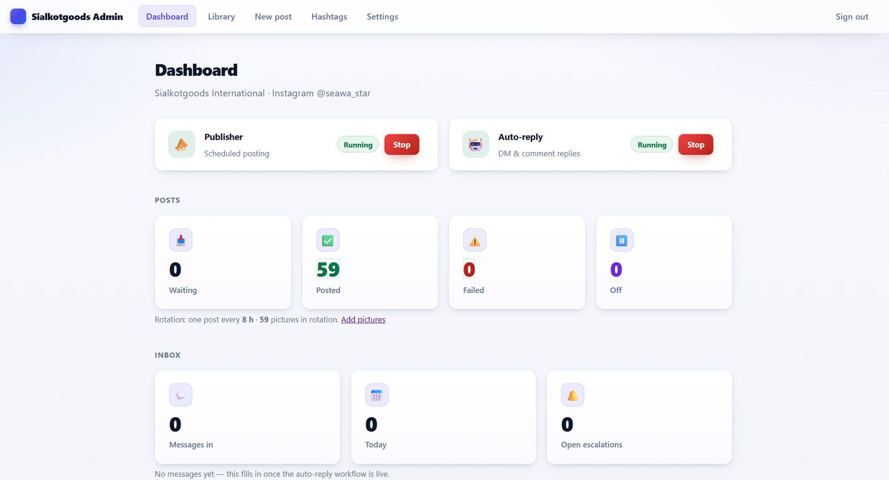
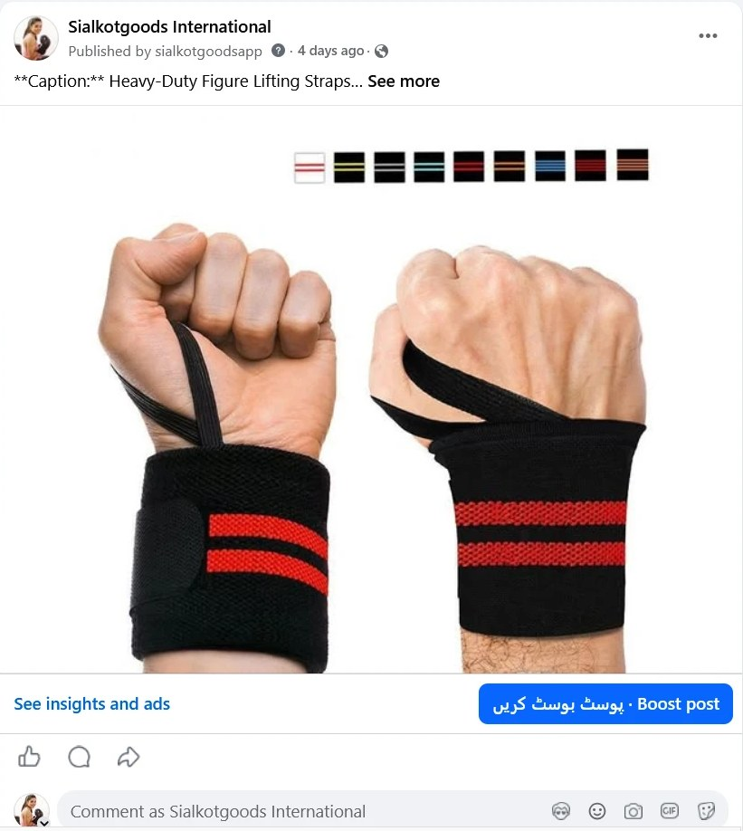
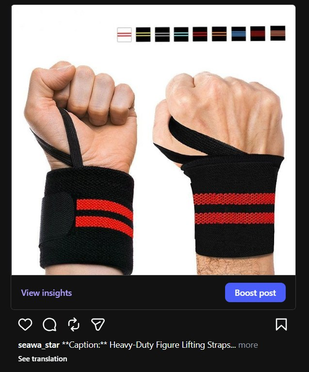
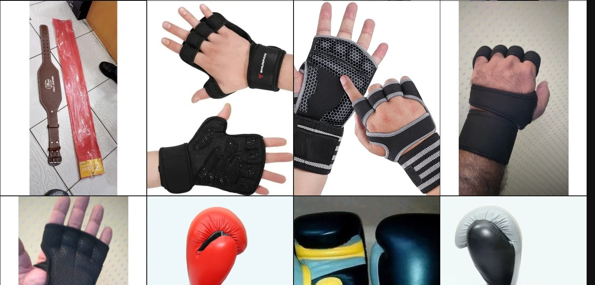
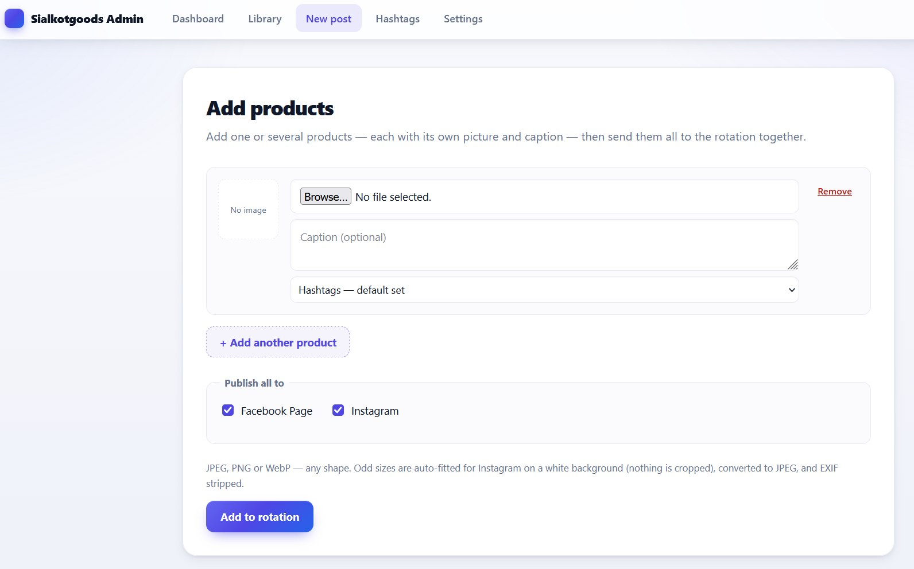
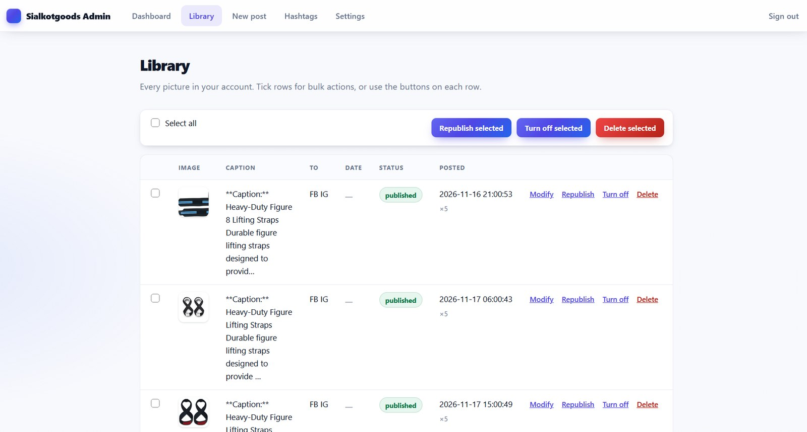
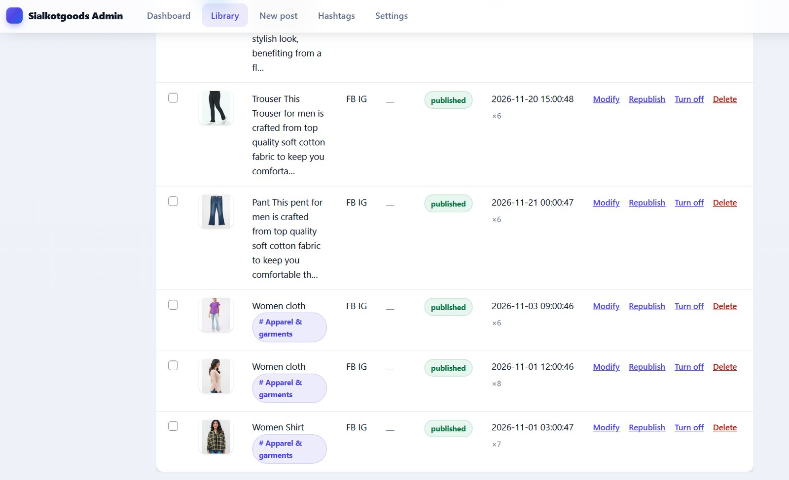
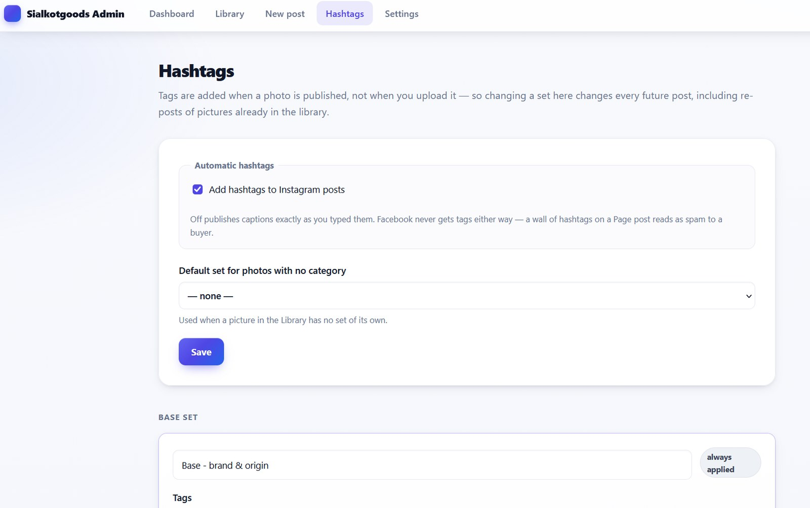
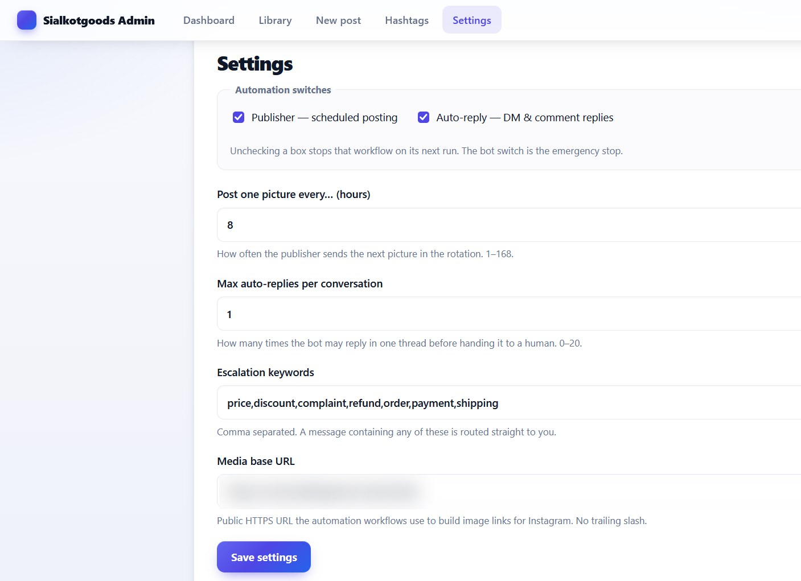
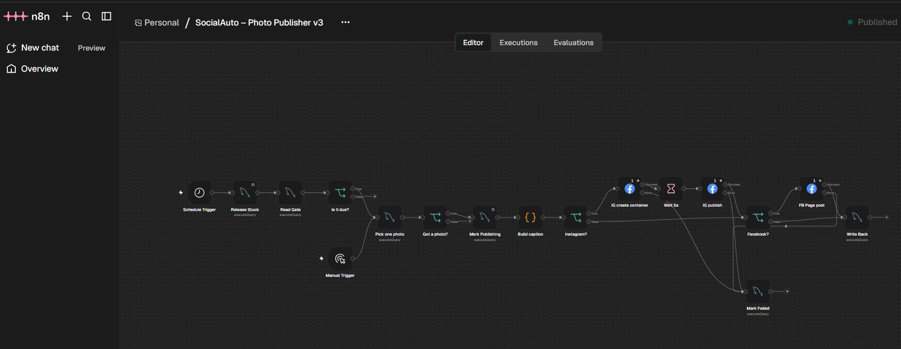

# SocialAuto — Social Media Publisher 📸🤖

**Automatic posting to Facebook and Instagram for a small export business.** The owner uploads product pictures once; the system publishes one post every few hours to the Facebook Page and Instagram at the same time, adds the right hashtags, and keeps repeating the rotation — with no daily work.

Designed and built by **Iftikhar Ahmed** with Claude Code (2026). **Running in production:** 59 posts published so far, 0 failed.

> This is a showcase. The source code is private. A live demo is available on request.

   
  <em>Dashboard: the Publisher and the Auto-reply can each be started or stopped with one button. 59 posts published, 0 failed, one post every 8 hours.</em>

## Real posts made by the system

The same product, posted automatically to both platforms at the same time:

| Facebook Page | Instagram |
|---|---|
|  |  |
| "Published by sialkotgoodsapp" — posted by the app, not by hand | The same post on Instagram |

   
  <em>The Instagram profile filling up with product posts from the rotation.</em>

---

## What it does

1. **Add products:** upload one or many pictures, each with its own caption, and choose Facebook Page, Instagram or both.
2. **Pictures are prepared automatically:** any shape is fitted for Instagram on a white background (nothing is cut off), converted to JPEG, and hidden photo data (EXIF) is removed.
3. **Every 8 hours** the publisher takes the next picture and posts it to **Facebook and Instagram at the same time**.
4. **Hashtags are added at the moment of posting**, by product category — so changing a hashtag set updates all future posts. Facebook posts get no hashtags, so they don't look like spam.
5. **The rotation repeats:** when all pictures are posted, it starts again. Each picture shows how many times it has been posted.
6. **Safe by design:** a picture is locked while posting so it is never posted twice; stuck or failed posts are released or marked, and the owner sees them on the dashboard.

## Screens

   
  <em>Add products: picture, caption and hashtag set for each product, then publish to Facebook Page and Instagram.</em>

   
  <em>Library: every picture with its caption, where it goes, status and last posting time. Republish, turn off or delete, one by one or in bulk.</em>

   
  <em>Published products with their category tag. "×6" means the picture has been posted six times in the rotation.</em>

   
  <em>Hashtags: a base set that is always added, plus sets by product category. Instagram only.</em>

   
  <em>Settings: on/off switches for each automation, how often to post (1–168 hours), and the rules for the auto-reply.</em>

   
  <em>The publisher as an automation flow: check if a post is due, pick and lock one picture, build the caption, post to Instagram and the Facebook Page, then record the result — or mark it failed.</em>

---

## Auto-reply (being rolled out)

A second automation answers **Instagram direct messages and comments**:

| Rule | How it works |
|---|---|
| Limited replies | The bot replies a set number of times in one conversation (now: 1), then hands it to a person |
| Escalation | Any message with words like price, discount, order, payment, shipping, complaint or refund goes straight to the owner |
| Emergency stop | One switch stops the bot at once |

## Main parts

| Part | What it does |
|---|---|
| Admin website | Dashboard, add products, library, hashtags, settings |
| Publisher | Posts to Facebook Page and Instagram on a schedule |
| Auto-reply | Answers messages and comments, hands difficult ones to a person |
| Picture service | Prepares and serves the pictures for Instagram |
| Database | Products, captions, hashtag sets, posting history |

## Built with

Claude Code · n8n (automation) · Meta Graph API (Facebook and Instagram) · PHP · MySQL · Linux server

---

**Contact:** iftikhar.ahmed.job1@gmail.com · [GitHub profile](https://github.com/iftikhar-ahmed-ai)

© 2026 Iftikhar Ahmed. All rights reserved.
